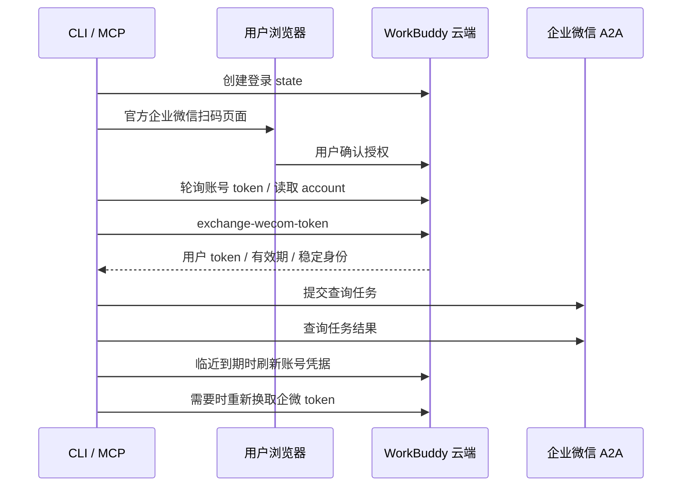

# 架构

Dayuan Lite 使用 Python 标准库实现授权与 A2A 协议，不加载桌面应用、插件或企业微信 SDK。

公开仓库包含独立 Python 实现与测试。

## 调用链

`workbuddy_auth.py` 管理官方云端会话；`dayuan.py` 管理 A2A、MCP、本地任务回执，并提供统一 CLI 入口 `dayuan`（`login`、`finish`、`renew`、`wecom-login` 转交 `workbuddy_auth.run`）。直接运行 `workbuddy_auth.py` 只是兼容层。状态目录默认 `~/.config/dayuan-lite`。

## 授权协议

固定云端域名为 `https://www.workbuddy.cn`。

| 步骤 | 请求 |
| --- | --- |
| 创建登录 | `POST /v2/plugin/auth/state?platform=workbuddy` |
| 用户登录 | 打开服务端返回的官方 `/login` 地址 |
| 轮询取票 | `GET /v2/plugin/auth/token?state=...` |
| 校验账号 | `GET /v2/plugin/account` |
| 企微换票 | `POST /console/enterprises/{enterpriseId}/oneid_openapi/exchange-wecom-token` |
| 账号续期 | `POST /v2/plugin/auth/token/refresh` |

浏览器登录 URL 使用版本参数 `5.8.2` 和 `force_login_type=wecom`。该版本的官方网页在版本参数缺失或低于 5.8.0 时进入不同的登录流程。参数只用于协议兼容，服务端仍校验实际账号与授权。

账号会话通过 Bearer 认证，续期额外使用 `X-Refresh-Token` 和 `X-Auth-Refresh-Source: plugin`。企微换票返回 `access_token`、`expires_in`、`alias_id`、`src_tid`。客户端组合用户与企业标识的哈希作为稳定身份，避免续期后把任务交给其他账号。

长期企微授权仍由云端维护。浏览器的 `/login/wecom-auth` 用于需要用户重新确认企微授权的情况，与账号 refresh token 续期不同。

## 失败与持久化

- 文件权限限制为目录 700、文件 600；凭据原子保存。
- 授权更新使用文件锁，避免多个进程同时轮换。
- 刷新前保存 `refresh_unknown`；成功后先保存新凭据，再读取账号信息。网络中断时不自动重放可能已经消耗的 refresh token。
- 账号或企微身份变化时拒绝继续旧任务。
- 提交前原子创建本地回执；不确定的提交结果不会自动再发送。
- 相同 `request_id`、相同输入用于恢复已有任务；相同 ID、不同输入返回冲突。

## 证据范围

本项目依赖上游当前行为，不承诺跨版本稳定，也不提供企业微信原始消息全量同步。
