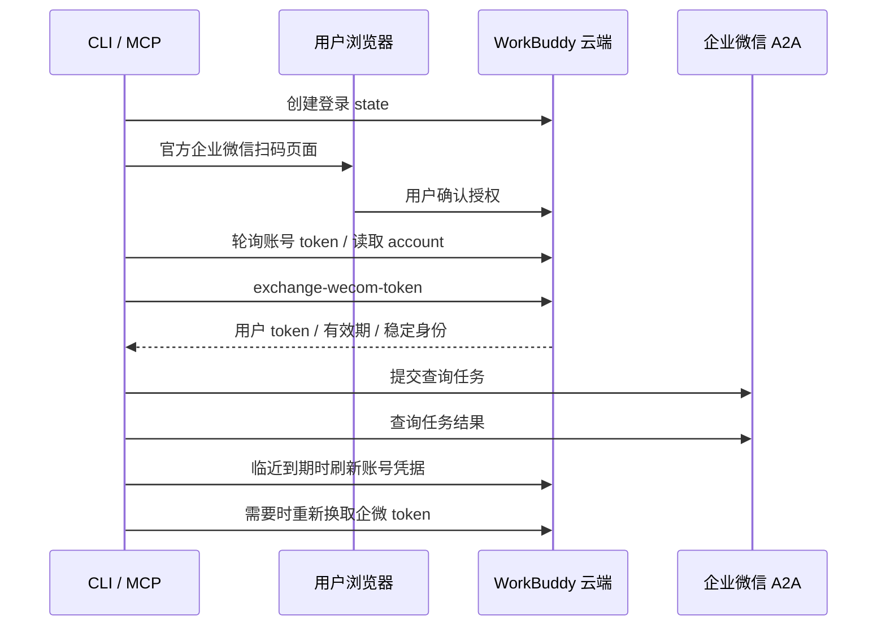

# 架构

Dayuan Lite 使用 Python 标准库实现账号授权与 A2A 调用，不需要安装或运行 WorkBuddy 桌面客户端，也不依赖企业微信 SDK。账号授权直接使用 WorkBuddy 官方云端服务，查询直接访问企业微信 A2A。

## 调用链

`workbuddy_auth.py` 管理官方云端会话；`dayuan.py` 管理 A2A、MCP、本地任务回执，并提供统一 CLI 入口 `dayuan`（`login`、`finish`、`renew`、`wecom-login` 转交 `workbuddy_auth.run`）。直接运行 `workbuddy_auth.py` 只是兼容层。状态目录默认 `~/.config/dayuan-lite`。

`wecom_bridge.py` 为第三个运行时模块，单独负责官方 CLI 子进程适配；不直接发 HTTP。`dayuan.py` 按需加载适配器，后者复用 `CloudAuth.ensure_wecom` 的锁、身份检查和续期状态机。第三模块将本次新增的子进程边界与原有两个模块的 HTTP 白名单隔离；Python 仍只用标准库，官方 CLI 是此可选功能的外部依赖。

## 授权协议

固定云端域名为 `https://www.workbuddy.cn`。

| 步骤 | 请求 |
| --- | --- |
| 创建登录 | `POST /v2/plugin/auth/state?platform=workbuddy` |
| 用户登录 | 打开服务端返回的官方 `/login` 地址 |
| 轮询取票 | `GET /v2/plugin/auth/token?state=...` |
| 校验账号 | `GET /v2/plugin/account` |
| 企微换票 | `POST /console/enterprises/{enterpriseId}/oneid_openapi/exchange-wecom-token` |
| 账号续期 | `POST /v2/plugin/auth/token/refresh` |

浏览器登录 URL 附带 `version=5.8.2` 和 `force_login_type=wecom`：官方登录页在版本参数缺失或低于 5.8.0 时会进入不同的登录流程。服务端仍校验实际账号与授权。

账号会话通过 Bearer 认证，续期额外使用 `X-Refresh-Token` 和 `X-Auth-Refresh-Source: plugin`。企微换票返回 `access_token`、`expires_in`、`alias_id`、`src_tid`。客户端组合用户与企业标识的哈希作为稳定身份，避免续期后把任务交给其他账号。

长期企微授权仍由云端维护。浏览器的 `/login/wecom-auth` 用于需要用户重新确认企微授权的情况，与账号 refresh token 续期不同。

## 失败与持久化

- 文件权限限制为目录 700、文件 600；凭据原子保存。
- 授权更新使用文件锁，避免多个进程同时轮换。
- 刷新请求发出前的最后一步保存 `refresh_unknown`；本地校验失败、等待预算耗尽、域名解析失败或连接被拒都发生在发送之前，状态保持 `ready`，下次可以再试。请求发出后网络中断时不自动重放可能已经消耗的 refresh token。成功后先保存新凭据，再读取账号信息。
- 账号或企微身份变化时拒绝继续旧任务。
- 每个请求 ID 使用独立进程锁，覆盖回执检查、被拒后的替换及提交；并发提交先等待锁最多 10 秒（`REQUEST_LOCK_WAIT`），超时后若回执已有 `task_id` 且输入一致就返回该任务的结果，输入不同返回 `REQUEST_CONFLICT`，回执不存在或尚无 `task_id` 才返回 `REQUEST_BUSY`；任何情况下都不会与持锁方并行提交。锁文件保留，避免删除后形成不同锁实例。
- 提交前原子创建本地回执；不确定的提交结果不会自动再发送。
- 相同 `request_id`、相同输入用于恢复已有任务；相同 ID、不同输入返回冲突。
- `result()` 拿到 `TERMINAL_STATES` 中的状态时，把 `normalize` 的输出整体写入回执的 `result` 字段（只有归一化后的字段，没有 token 和上游原始响应体；回执文件权限为 600、私有目录权限为 700）。之后同一 ID 的 `result()` 在通过凭据/身份检查后直接返回该副本，不再发 A2A 查询；非终态回执没有 `result` 字段，每次仍联网。授权预检（`prepare_auth`）在缓存命中前仍会执行，临近到期时可能触发一次云端续期。
- 回执和锁文件不会自动清理。`dayuan list` 只读取 `requests/*.json` 并按 `created_at` 倒序输出摘要字段；`dayuan gc --older-than Nd` 只处理 `TERMINAL_STATES`（`completed` / `failed` / `cancelled` / `rejected`）且创建时间早于 N 天的回执，默认只预览，加 `--yes` 才删除。删除前以 `LOCK_NB` 尝试取得该请求的锁，取不到就跳过；实际删除时创建缺失锁文件，取锁后重新读取回执并核对终态及创建时间，只删除仍符合条件的回执，永久保留锁文件，避免等待中的提交者使用不同锁实例。预览不创建锁文件。非终态（含 `outcome_unknown`、`dispatching`）永不删除，无法解析的回执按 `unreadable` 列出且不删除。两个命令不发网络请求，也不作为 MCP 工具暴露。

## 等待预算

首次提交或首次结果查询返回后启动等待预算。休眠后再次检查截止时间；后续 A2A 查询、云端授权请求和授权锁均按同一单调时钟计算剩余时间，网络超时取默认值与剩余时间的较小者。超时保留已接受任务和原 request_id，不会重新提交。预算在调用结束时恢复，不影响后续独立调用。底层 HTTP 超时属于 I/O 超时，不提供整个进程的强制截止保证。

## 稳定性

本项目依赖上游当前行为，不承诺跨版本稳定，也不提供企业微信原始消息全量同步。

## 企微 CLI 适配边界

调用链：CLI `wecom` / MCP `dayuan_wecom_read` → 校验参数白名单 → 官方 CLI 版本检查 → CloudAuth 检查并按需续期 → 临时隔离配置、环境注入用户令牌 → 固定 CLI 只读命令 → 有界 JSON 解析与错误脱敏 → 临时正文文件内联 → 清理进程与临时目录。

| 连接器操作 | 唯一允许的官方 CLI 命令 |
| --- | --- |
| `doc-search` | `doc search --json …` |
| `doc-read` | `doc contents get --json …` |
| `meeting-list` | `meeting list --json …` |
| `meeting-get` | `meeting get --json …` |

不新增 HTTP 主机或自建端点。适配器仅在 `run_cli` 通过 `Popen` 启动受信任的 CLI，不使用 shell。继承环境中的全部 `WECOM_CLI_*` 被清除，只设置临时 `WECOM_CLI_CONFIG_DIR` 和当前 `WECOM_CLI_ACCESS_TOKEN`，同时移除 `DAYUAN_ACCESS_TOKEN` 以及可向 Node 进程注入代码的 `NODE_OPTIONS` / `NODE_PATH`。CLI 版本按可执行文件的路径、mtime 和大小在进程内缓存，`serve` 模式下每个二进制只检查一次，重装后重新检查。CLI 路径由本机参数或环境指定，MCP 请求不能指定程序路径。版本检查时不注入 token。

标准输出限 2MiB，超限报错；标准错误只保留前 64KiB、持续读空、从不回传，再多也不影响本次读取；子进程等待有总预算，超时/超限终止进程组并回收进程；两个管道都到 EOF 后只缺退出码，此时按剩余预算与 2 秒退出宽限（`EXIT_GRACE`）的较大值等待，避免完整输出被当作超时丢弃，也不缩短尚未耗尽的预算。原始 stderr、异常响应和版本输出不回显；业务错误只保留数字机器码。成功数据中匹配当前令牌的字符串被替换。临时配置目录在调用结束后删除，CLI 写出的正文文件仅允许在该目录内、是普通文件且读取后总响应仍不超过 2MiB；内联到 `content`，若 CLI 已返回 `content` 则放入 `file_content`；越界路径、链接或非文本正文报错。

令牌错误 `853004` / `853005` 仅允许重换企微令牌后重试一次，操作仍是白名单只读请求；不重复提交 A2A 任务。其他错误直接停止，沿用 CloudAuth 对不确定 refresh token 轮换的保护。
